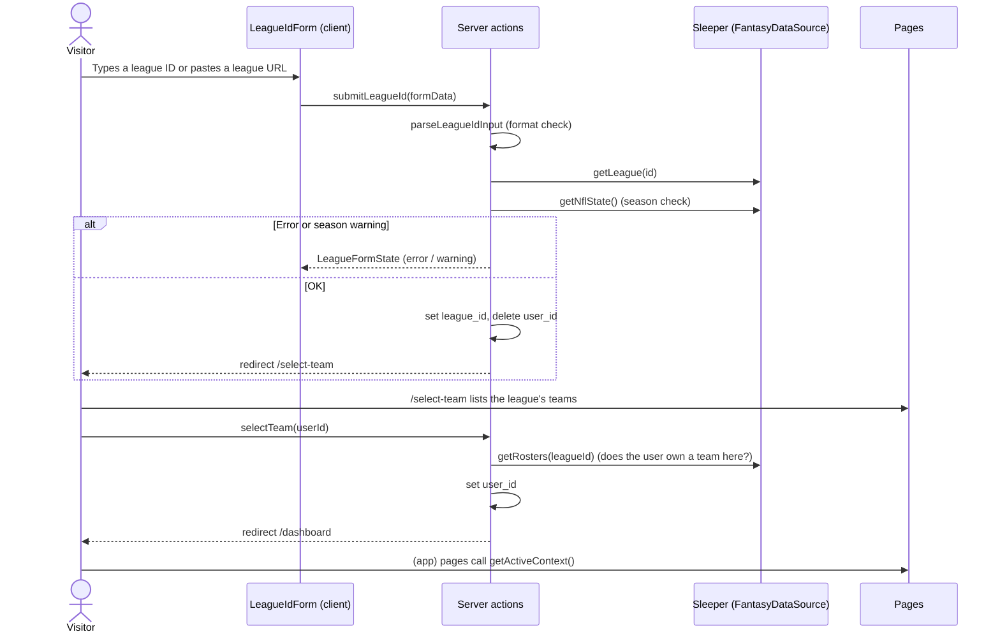

# League and team selection

How the app decides whose team to show, and how a visitor switches from the demo team to their own Sleeper team.

Decision record: [ADR 0001](../adr/0001-active-league-and-team-in-cookies.md).

## The three modes

Every request is in exactly one mode, decided from two cookies by `resolveActiveContext` in `src/lib/active-context.ts`.

| Mode           | `league_id` cookie | `user_id` cookie   | What the visitor sees                                         |
| -------------- | ------------------ | ------------------ | ------------------------------------------------------------- |
| **Demo**       | missing or invalid | (ignored)          | The demo league and team from `src/config/demo.ts`            |
| **Needs team** | valid              | missing or invalid | Any page in `(app)` redirects to `/select-team`               |
| **Own team**   | valid              | valid              | Their league and team on `/dashboard`, `/team`, and `/trades` |

- **Valid** means the cookie matches `SLEEPER_ID_PATTERN` (digits only, `src/lib/league-cookies.ts`). A tampered or garbled cookie is treated as missing, never passed to Sleeper.
- In demo mode a leftover `user_id` is ignored, because it belongs to a league that's no longer chosen.

## Request flow

Step by step:

1. **Enter a league.** `LeagueIdForm` (home page, `#league-id`) submits to the `submitLeagueId` server action through React's `useActionState`. The Navbar's "Enter League ID" links to `/#league-id`, so it works from any page.
2. **Validate.** The action checks the format, confirms the league exists, and warns once if it's from another season (see [Outcomes](#outcomes-of-each-action)).
3. **Choose the league.** On success it sets `league_id`, deletes `user_id` (a team picked in another league no longer applies), and redirects to `/select-team`.
4. **Pick a team.** `/select-team` lists every team with avatar, team name, owner and record, and marks the current pick. Each team is a small form that posts `userId` to `selectTeam`.
5. **Confirm ownership.** `selectTeam` checks that the user owns a roster in the chosen league, sets `user_id`, and redirects to `/dashboard`.
6. **Render.** The `(app)` layout and each page call `getActiveContext()`, which returns `{ leagueId, userId, isDemo }`, or redirects to `/select-team` if a league has no team yet.

## Cookies

| Cookie      | Holds                  | Set by           | Cleared by                                  |
| ----------- | ---------------------- | ---------------- | ------------------------------------------- |
| `league_id` | Chosen Sleeper league  | `submitLeagueId` | `backToDemo`                                |
| `user_id`   | Chosen owner's user ID | `selectTeam`     | `submitLeagueId` (new league), `backToDemo` |

- Options (`COOKIE_OPTIONS`, `src/lib/league-selection.ts`): `HttpOnly`, `SameSite=Lax`, `Path=/`, one year. `Secure` in production.
- Cookies are only written in server actions. Next.js doesn't allow setting cookies while a Server Component renders.

## Outcomes of each action

### `submitLeagueId` (league form)

| Input or situation                     | Result                                                                                                  |
| -------------------------------------- | ------------------------------------------------------------------------------------------------------- |
| Empty                                  | Error: "Enter your Sleeper league ID."                                                                  |
| Not 6–32 digits (after URL extraction) | Error: "A league ID is a long number, like 1360246916935340032. Check for typos." Sleeper isn't called. |
| `sleeper.com/leagues/<id>/…` URL       | The ID is taken from the URL, then checked as above                                                     |
| Sleeper returns 404                    | Error: "We couldn't find a Sleeper league with that ID."                                                |
| Sleeper fails any other way            | Error: "We couldn't reach Sleeper just now. Please try again in a moment."                              |
| League season ≠ current NFL season     | Warning naming both seasons, with a "Use it anyway" button                                              |
| "Use it anyway" for the same league    | Accepted. The confirmation only counts for the league ID it was shown for.                              |
| NFL state can't load                   | The season check is skipped, so the visitor isn't blocked                                               |
| Valid                                  | Sets `league_id`, deletes `user_id`, redirects to `/select-team`                                        |

### `selectTeam` (`/select-team`)

| Situation                         | Redirects to                         |
| --------------------------------- | ------------------------------------ |
| No valid `league_id` cookie       | `/#league-id`                        |
| `userId` isn't a valid ID         | `/select-team?error=team`            |
| User owns no roster in the league | `/select-team?error=team`            |
| Rosters can't load                | `/select-team?error=unavailable`     |
| Valid                             | Sets `user_id`, goes to `/dashboard` |

`/select-team` turns the `error` code into a message above the list.

### `backToDemo`

Deletes both cookies and redirects to `/dashboard`. Used by the banner, by `/select-team`, and by the home page's "Try the Demo" button, so that button always opens the demo team.

## Where the code lives

| File                                        | Layer                      | Role                                                                                      |
| ------------------------------------------- | -------------------------- | ----------------------------------------------------------------------------------------- |
| `src/config/demo.ts`                        | Config                     | `DEMO_LEAGUE_ID`, `DEMO_USER_ID`. Only `active-context.ts` imports them.                  |
| `src/lib/league-cookies.ts`                 | Shared (no server imports) | Cookie names and `SLEEPER_ID_PATTERN`                                                     |
| `src/lib/league-form.ts`                    | Shared (no server imports) | `LeagueFormState` and its initial value, used by the client form                          |
| `src/lib/active-context.ts`                 | Server                     | `resolveActiveContext` (pure), `getActiveContext`, `getChosenLeagueId`, `getChosenUserId` |
| `src/lib/league-selection.ts`               | Server                     | The actions' logic, with dependencies passed in so it can be unit tested                  |
| `src/app/actions/league.ts`                 | Server actions             | `"use server"` wrappers that pass in Next's `cookies()`, `redirect`, and `sleeperClient`  |
| `src/lib/team-choices.ts`                   | Shared                     | Joins rosters to owners for `/select-team`                                                |
| `src/app/select-team/page.tsx`              | Page                       | Team list. Outside `(app)` on purpose (see below).                                        |
| `src/app/(app)/layout.tsx`                  | Layout                     | Calls `getActiveContext()` and renders `ModeBanner`                                       |
| `src/components/league/LeagueIdForm.tsx`    | Client component           | The league form                                                                           |
| `src/components/league/ModeBanner.tsx`      | Server component           | Demo notice, or league name with "Switch team" and "Back to demo"                         |
| `src/components/league/UserAvatar.tsx`      | Component                  | Sleeper avatar, or the owner's initial                                                    |
| `src/application/ports/DataSourceErrors.ts` | Application port           | `DataSourceNotFoundError`, thrown by the Sleeper adapter on a 404                         |

## Rules to keep

These are easy to break by accident. Each one caused, or would cause, a real bug.

- **`/select-team` stays outside the `(app)` group.** The `(app)` layout redirects "league but no team" visitors to `/select-team`. If that page were inside the group, it would redirect to itself forever.
- **Client code never imports a module that uses `next/headers`.** `LeagueIdForm` is a client component, so the shared constants and form state live in `league-cookies.ts` and `league-form.ts`, which have no server imports. Importing `active-context.ts` from client code fails the build.
- **`redirect()` is called outside `try` blocks.** It works by throwing, so a `try/catch` around it would swallow the redirect. The actions record a failure in a variable inside `try`, then redirect after it.
- **Pages get the league and user only from `getActiveContext()`.** No page imports `DEMO_USER_ID` or reads the cookies directly.
- **"Not found" is a typed error.** The Sleeper adapter throws `DataSourceNotFoundError` on a 404, so the form can tell an unknown league from an outage. Any new data source should do the same.

## Testing

| What                                              | Test file                                         |
| ------------------------------------------------- | ------------------------------------------------- |
| Every mode and cookie case                        | `tests/unit/lib/active-context.test.ts`           |
| Every action outcome above                        | `tests/unit/lib/league-selection.test.ts`         |
| Team list for `/select-team`                      | `tests/unit/lib/team-choices.test.ts`             |
| 404 → `DataSourceNotFoundError`, blank team names | `tests/unit/infrastructure/SleeperClient.test.ts` |

The action tests pass a fake `redirect` that throws, like the real one, so each test checks both where the visitor is sent and that the code stops there.

To try it by hand (`npm run dev`):

1. Enter `1385208417068539904` (a current-season league) on the home page and pick a team.
2. Enter `1195142787739951104` (a 2025 league) to see the season warning.
3. Use "Back to demo" in the banner to return to the demo team.

## Known limitations

- **Teams with no owner:** the roster parser requires every team to have an `owner_id`, so a league with an abandoned team fails to load its rosters. `buildTeamChoices` already skips ownerless teams; the parser needs to allow `null`.
- **No accounts:** the choice lives in the visitor's browser. Clearing cookies or switching devices returns them to the demo.
